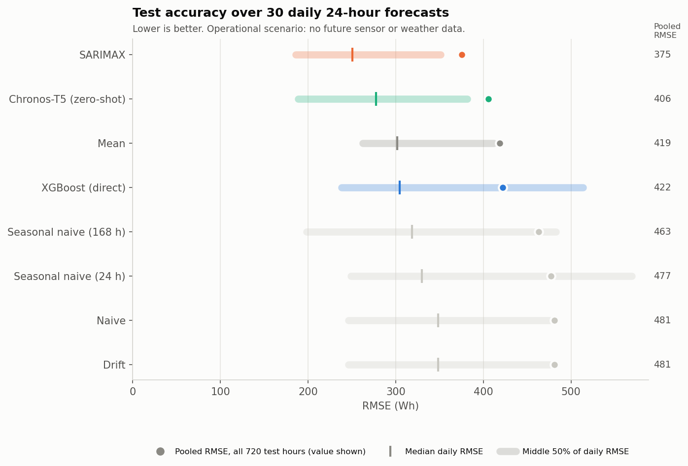
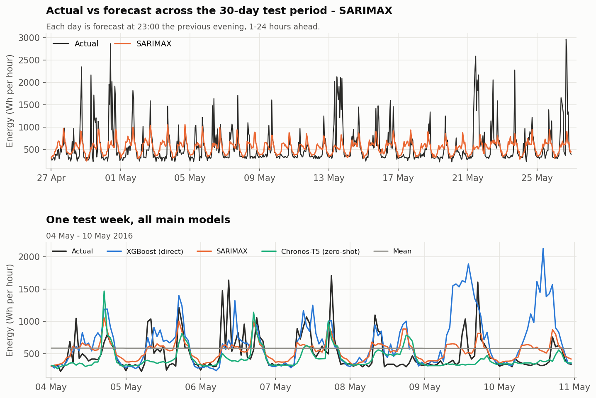
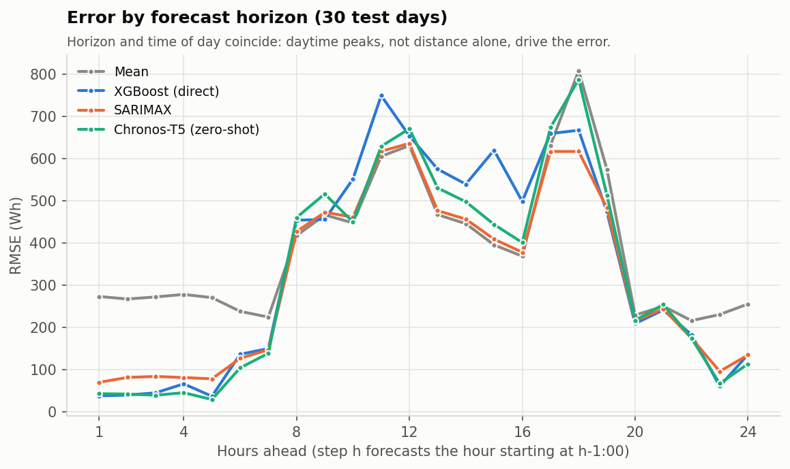
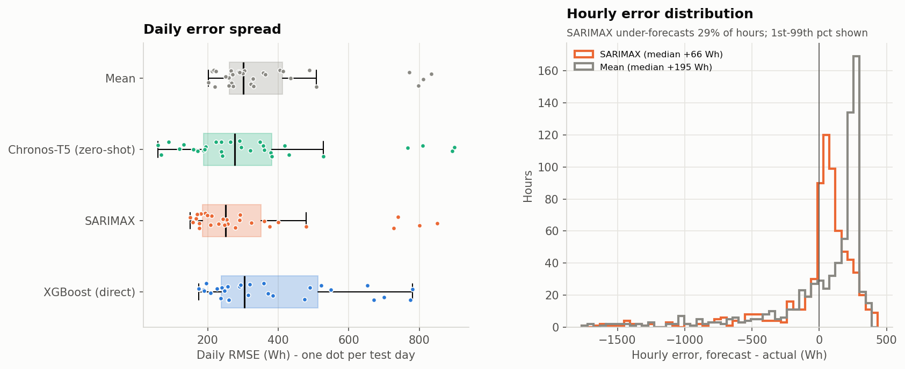
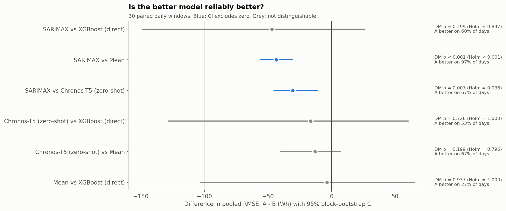
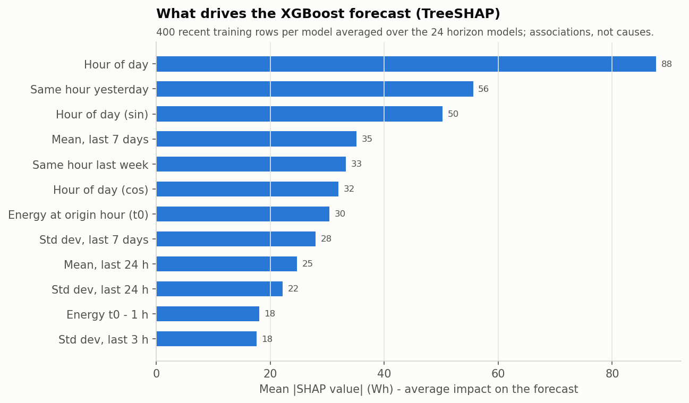
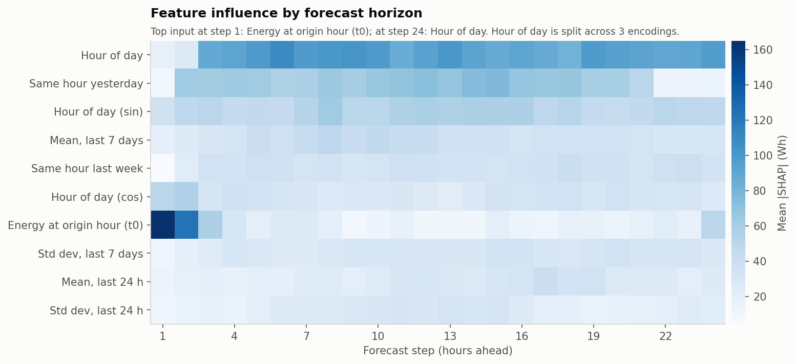
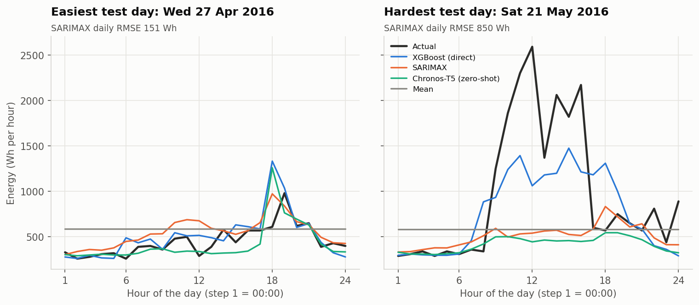

# Appliance Energy Forecasting

Day-ahead forecasting of household appliance energy use, evaluated the way a
forecast would actually be used: every evening at 23:00 the models predict the
next 24 hours using **only information available at that moment**. Seasonal
benchmarks, SARIMAX, gradient-boosted trees (recursive and direct XGBoost) and
a pretrained time-series foundation model (Chronos-T5) are compared on **30
identical forecast days**. Paired statistical tests show whether the
differences are real.



## Why this project

Short-term appliance demand forecasts underpin smart-home scheduling, battery
charging and demand-response programmes. Household demand is spiky and
behaviour-driven, which makes it a good stress test: easy to overfit, easy to
leak future information into, and hard to beat with simple baselines. This
project focuses on doing the evaluation **correctly**:
- no future target, sensor or weather data at forecast time;
- model choices made on validation data only;
- one untouched test period;
- uncertainty reported at the level of independent forecast days.

## Results

<!-- RESULTS:START -->
**Test period:** 27 Apr 2016 – 26 May 2016 · 30 daily forecasts made at 23:00 for the next 24 hours (720 hourly targets) · operational scenario (only past data + calendar at forecast time) · models fitted once on train+validation data.

| Model | RMSE (Wh) | MAE (Wh) | sMAPE (%) | MASE | Median daily RMSE | RMSE vs Mean |
|---|---:|---:|---:|---:|---:|---:|
| **SARIMAX** | 375.2 | 217.7 | 32.8 | 0.67 | 250.5 | +10.4% |
| Chronos-T5 (zero-shot) | 405.8 | 197.7 | 27.8 | 0.61 | 277.3 | +3.1% |
| Mean | 418.7 | 290.7 | 47.0 | 0.90 | 301.8 | +0.0% |
| XGBoost (direct) | 422.2 | 253.8 | 34.2 | 0.79 | 304.4 | -0.8% |
| Seasonal naive (168 h) | 463.3 | 245.8 | 31.7 | 0.76 | 318.7 | -10.7% |
| Seasonal naive (24 h) | 477.1 | 263.0 | 34.9 | 0.82 | 330.0 | -13.9% |
| Naive | 481.1 | 262.7 | 41.1 | 0.81 | 348.3 | -14.9% |
| Drift | 481.2 | 262.8 | 41.1 | 0.81 | 348.3 | -14.9% |

**Decisions made on validation only (14 days, test unseen):**

- XGBoost strategy: **XGBoost (direct)** — validation RMSE XGBoost (recursive) 447.3, XGBoost (direct) 408.8
- SARIMAX order: **(1, 1, 6)×(1, 0, 1, 24)** — AIC compared only within each differencing order, then validation RMSE (400.9); stage-1 fits: {'converged': 133, 'not_converged': 14}
- Reference benchmark: **Mean** (best benchmark on validation)

**Paired comparison over the 30 test days** (Diebold–Mariano on daily MSE with HAC variance, Holm-corrected; 95% moving-block bootstrap CI for the RMSE difference):

| A (lower RMSE) | B | RMSE diff A−B | 95% CI | DM p (Holm) | A wins | Evidence |
|---|---|---:|---|---:|---:|---|
| SARIMAX | XGBoost (direct) | -47.0 | [-149.0, +26.3] | 0.897 | 60% | not distinguishable |
| Chronos-T5 (zero-shot) | XGBoost (direct) | -16.4 | [-128.4, +60.5] | 1.000 | 53% | not distinguishable |
| Mean | XGBoost (direct) | -3.5 | [-103.1, +65.6] | 1.000 | 27% | not distinguishable |
| SARIMAX | Chronos-T5 (zero-shot) | -30.6 | [-45.3, -10.8] | 0.036 | 67% | A better (significant after Holm, CI excludes 0) |
| SARIMAX | Mean | -43.5 | [-55.6, -31.0] | < 0.001 | 97% | A better (significant after Holm, CI excludes 0) |
| Chronos-T5 (zero-shot) | Mean | -12.9 | [-39.8, +7.3] | 0.796 | 67% | not distinguishable |

**Prediction-interval coverage on test:** Chronos-T5 (zero-shot) 80% interval covered 58.1% of hours (mean width 230 Wh); SARIMAX 95% interval covered 95.8% of hours (mean width 1405 Wh)

**Upper bound, not an operational result:** with *observed* future outdoor weather (`weather_oracle`), XGBoost (direct) reaches test RMSE 402.8 Wh vs 422.2 Wh operationally (-4.6%): an upper bound on what perfect weather forecasts could add.

**SHAP (model inputs, not causes):** the most influential inputs are Hour of day, Same hour yesterday and Hour of day (sin).
<!-- RESULTS:END -->

### Key findings

- **SARIMAX is the only model with statistically supported gains.** On the best validation benchmark (mean), it beats it on 29 of 30 test days. Its RMSE is 10.4% lower, the 95% bootstrap CI for the difference excludes zero, and DM p < 0.001 after Holm correction.
- **Direct XGBoost beat recursive XGBoost on validation** (RMSE 408.8 vs 447.3), so only the direct variant was evaluated on test. On test it ties the mean benchmark on RMSE (422 vs 419). It still wins on 73% of days and has 13% lower MAE, which means it is better on typical days but pays for a few large misses.
- **SARIMAX vs direct XGBoost cannot be separated** with 30 test days: the CI of the RMSE difference spans zero.
- **Errors are driven by unpredictable usage spikes.** Daytime hours carry most of the error for every model.
- **SARIMAX intervals are well calibrated.** Its 95% prediction interval covered 95.8% of test hours.
- **Chronos-T5 (zero-shot)** runs on the same 30 days via `--stages chronos`, on a machine where its weights are cached. Its row and paired tests then appear in the table above.
- **Perfect weather knowledge would add little.** Giving XGBoost the *observed* future outdoor weather improves RMSE by only 4.6%. This is an upper bound, reported separately and never as operational accuracy.

## Visuals

| | |
|---|---|
|  |  |
|  |  |
|  |  |



## Dataset

[UCI Appliances Energy Prediction](https://archive.ics.uci.edu/dataset/374/appliances+energy+prediction)
(Candanedo et al., 2017; CC BY 4.0). It covers one low-energy house in Belgium,
11 Jan – 27 May 2016, at 10-minute resolution:
- **Target:** appliance energy in Wh.
- **Indoor sensors:** temperature and humidity from 9 rooms.
- **Outdoor weather:** from a nearby station.

**Preparation** (`src/data.py`):
- Readings are aggregated to hours: energy is summed and sensors are averaged.
- Hours with fewer than the expected 6 readings are excluded. Only one hour is affected: the file ends at 2016-05-27 18:00, a bin holding 1 of 6 readings.
- **Result:** 3,289 complete hourly observations, with no missing values and no duplicate timestamps.

The pipeline downloads the CSV on first run into `data/raw/` (git-ignored).

## Methodology

### Forecasting protocol (`src/protocol.py`)
- **Origin:** 23:00 each day, the last observed hour. **Targets:** the next 24 hours, 00:00–23:00.
- **Splits (chronological):**

  | Partition | Forecast days | Use |
  |---|---|---|
  | Train | 11 Jan – 12 Apr 2016 | Fitting |
  | Validation | 14 days, 13 – 26 Apr | **Every** modelling decision |
  | Test | 30 days, 27 Apr – 26 May | Touched once, at the end |

  Windows never overlap. Models are fitted once on all data before the first origin of a partition, then condition on newly observed history at each origin.
- **Feature availability** (enforced in code and by tests):

  | Information | At forecast time |
  |---|---|
  | Calendar (hour, weekday, weekend) | known for target hours |
  | Past energy use, indoor sensors, weather | only up to the origin |
  | Future outdoor weather | only in the separate `weather_oracle` upper-bound scenario |
  | Future energy use / indoor sensors | never |

- **Leakage tests** replace every value after the origin with noise and require identical forecasts from every model.

### Models
| Model | Configuration |
|---|---|
| Benchmarks | mean, naive, drift, seasonal naive (24 h and 168 h) |
| SARIMAX | seasonal (1,0,1,24) on a 45-day window. Order chosen in two stages: AIC compared **only within** each differencing order d (non-converged fits excluded, convergence logged), then the best candidates per d ranked by **validation** RMSE. |
| XGBoost, recursive | lags 1/2/3/24/48/168 h, rolling mean/std 3/6/24 h, calendar. Predictions fed back for later steps. |
| XGBoost, direct | 24 horizon-specific models. Inputs observable at the origin (recent lags, rolling stats, same hour yesterday / last week) plus the target hour's calendar. No error accumulation. |
| Chronos-T5-small | zero-shot pretrained transformer (Ansari et al., 2024), median of 20 samples, 80% interval |

Both XGBoost variants share the same hyper-parameters (600 trees, learning rate 0.03, depth 6). The strategy reported on test was chosen on validation.

### Evaluation
- **Metrics:** RMSE, MAE, MAPE and sMAPE (zero-safe), plus MASE. Each is pooled over all 720 test hours and summarised per forecast day.
- **Paired comparisons** use the 30 daily windows as the unit:
  - Diebold–Mariano on daily MSE with a Newey–West variance and small-sample correction;
  - a 95% moving-block bootstrap interval for the RMSE difference;
  - win rates;
  - Holm correction across comparisons.
- **Explainability:** exact TreeSHAP (XGBoost's built-in `pred_contribs`) for the final operational model, computed on recent *training* rows.

## Architecture

```
run_backtest.py                 CLI: one rolling-origin backtest (validation by default)
scripts/run_final_experiment.py the complete experiment, stage by stage
src/
  data.py          download, hourly aggregation, completeness checks
  protocol.py      origins, partitions, history/future views, scenarios
  forecasters.py   common fit/predict adapters for every model
  backtest.py      runner, identical-target checks, metrics, provenance
  sarimax_selection.py  within-d AIC + validation selection, convergence logging
  metrics.py       RMSE / MAE / MAPE / sMAPE / MASE
  stats_tests.py   Diebold–Mariano, block bootstrap, Holm, interval coverage
  explain.py       TreeSHAP for XGBoost
  final_analysis.py tables, figures and the results block of this README
  benchmarks.py, sarimax_model.py, ml_model.py, foundation.py, features.py
                   model implementations (original study, reused by the adapters)
tests/             65 tests: leakage, alignment, splits, metrics, statistics, end-to-end
outputs/final/     sarimax_selection/ validation/ test/ test_chronos/
                   test_weather_oracle/ analysis/ figures/ RESULTS.md
outputs/metrics, outputs/figures   original single-window study (historical, protected)
```

## Reproduce

```bash
python -m pip install -r requirements.txt            # core (Python 3.12 tested)
python -m pip install -r requirements-chronos.txt    # optional: Chronos (PyTorch)
python -m pytest -q                                  # test suite
python run_backtest.py --dry-run                     # data quality + partitions
python scripts/run_final_experiment.py               # full experiment (~20-30 min on a 6-core laptop CPU)
python scripts/run_final_experiment.py --stages chronos,analysis   # add Chronos later
```

- `requirements-lock.txt` lists the exact versions of the verified environment.
- **Experiment folders are never overwritten.** Re-running skips finished stages and only regenerates the derived analysis.
- **Historical outputs are protected.** `run_pipeline.py` (the original single-window study) refuses to replace `outputs/metrics` and `outputs/figures` unless given `--overwrite-legacy`.

## Limitations

- **One household, 4.5 months.** The 30 test days are all in late spring; results may not transfer to other homes or seasons.
- **30 forecast days give limited statistical power.** "Not distinguishable" means the data cannot separate the models, not that they are equivalent.
- **SARIMAX selection:**
  - its six finalists differed by only ~1.5% on validation;
  - the chosen order (1,1,6) sits on the q = 6 edge of the original grid;
  - parameters are estimated on a 45-day window and fixed during the test period. Only the state is updated daily.
- **XGBoost:** hyper-parameters are the original hand-set values, not tuned. The direct/recursive choice rests on 14 validation days.
- **Platform reproducibility.** With identical package versions, XGBoost results differ slightly between Linux and Windows builds (validation RMSE 447.3 vs 459.7 for the recursive model), from floating-point and compiler differences. Results are reproducible on a given platform.
- **Chronos** is used zero-shot. The checkpoint reads at most the last 512 hours, and only 20 samples are drawn.
- **`weather_oracle`** uses observed weather, not archived forecasts, so it overstates what a real weather forecast could provide.
- **SHAP values describe associations learned by the model, not causes.** Time of day is split across three encodings (hour, sin, cos), which share its credit.

## Project history

This repository began as a single-window study: one 24-hour test day, with XGBoost using same-hour indoor sensor readings. Its results remain in `outputs/metrics`, `outputs/figures` and `report/`.

An audit found three problems:
- one test day is far too few to rank models;
- the indoor sensors respond to appliance use within the hour, so they leak information about the target;
- the final hourly bin was incomplete.

The current pipeline fixes all three. Its numbers supersede the original RMSE of 377 Wh.

## References

- Candanedo, Feldheim & Deramaix (2017). Data driven prediction models of energy use of appliances in a low-energy house. *Energy and Buildings*, 140.
- Hyndman & Athanasopoulos. *Forecasting: Principles and Practice* (3rd ed.).
- Diebold & Mariano (1995); Harvey, Leybourne & Newbold (1997). Comparing predictive accuracy.
- Chen & Guestrin (2016). XGBoost. Lundberg et al. (2020). From local explanations to global understanding with explainable AI for trees.
- Ansari et al. (2024). Chronos: Learning the language of time series.
